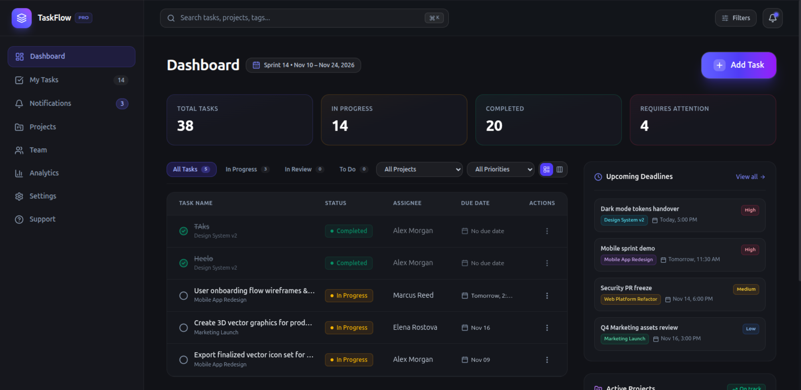
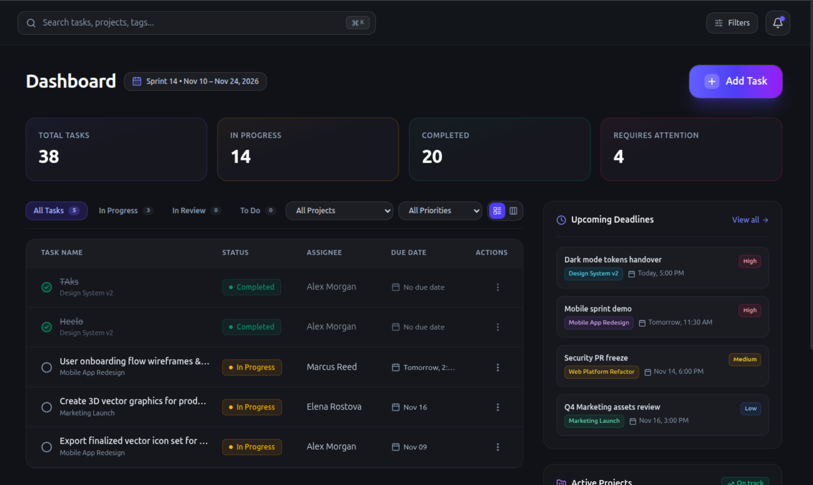
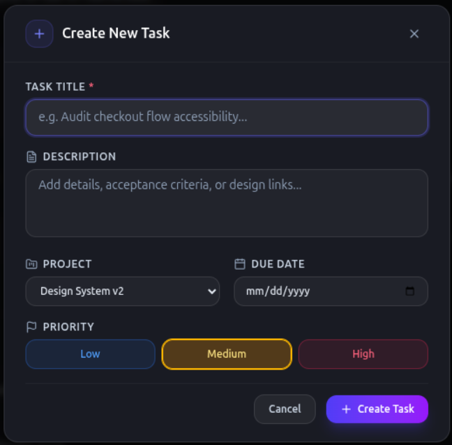

# TaskFlow — Modern Dark UI Task Manager

<div align="center">


A responsive, high-performance task management dashboard built with **React 19**, **Vite**, and **Tailwind CSS v4**. Inspired by modern SaaS dashboard design standards, featuring frosted glassmorphism, responsive data tables, comprehensive task CRUD workflows, and local storage persistence.

[Features](#key-features) • [Screenshots](#dashboard-preview) • [Tech Stack](#technologies-used) • [Getting Started](#getting-started) • [Project Structure](#project-structure)

</div>

---

## Dashboard Preview

<div align="center">
  
  <p align="center"><em>Full Dashboard View: Left Sidebar Navigation, Header Search, Summary Statistics, Tasks Table, and Companion Widgets</em></p>
</div>

<br/>

<div align="center">
  <table>
    <tr>
      <td width="65%" align="center">
        
        <br/>
        <em><strong>Dashboard Workspace & Statistics</strong></em>
      </td>
      <td width="35%" align="center">
        
        <br/>
        <em><strong>Tasks Table & Actions</strong></em>
      </td>
    </tr>
  </table>
</div>

---

## Key Features

- **Intuitive Dark UI**: Tailored with custom color palettes (`#090a10` canvas, `#11131c` frosted cards, indigo-to-purple accents), glowing gradients, and custom scrollbars.
- **Full Task Lifecycle (CRUD)**:
  - **Create**: Add new tasks with title, description, project category, priority tier, and due dates via a clean modal dialog.
  - **Read & Complete**: Mark tasks completed with interactive checkboxes, strikethrough styling, and instant category count sync.
  - **Edit**: Pre-fill and update task data on the fly.
  - **Delete**: Safe task removal backed by an explicit confirmation prompt.
- **Responsive Tasks Table**:
  - Engineered without horizontal scrolling using a fluid fixed table layout.
  - Displays **Task Name**, **Status Badge**, **Assignee** (plain text), **Due Date**, and **Actions (⋮)** menu.
  - Automatic text truncation and adaptive padding for mobile, tablet, and desktop screens.
- **Multi-criteria Filtering & Search**:
  - Quick-switch status tabs (`All`, `In Progress`, `In Review`, `To Do`, `Completed`) with dynamic item counters.
  - Project workspace dropdown filter.
  - Priority level filter (`High`, `Medium`, `Low`).
  - Global search bar with instant query matching across task titles, descriptions, and projects.
- **Local Storage Persistence**:
  - Automatically serializes tasks to `localStorage` on any state change.
  - Safe lazy initialization with graceful fallback recovery against corrupted data or disabled cookies.
- **Refined Navigation & Sidebar**:
  - Unified 8-item navigation (`Dashboard`, `My Tasks`, `Notifications`, `Projects`, `Team`, `Analytics`, `Settings`, `Support`).
  - Dedicated bottom user profile card with avatar and status dot.
  - Mobile slide-over drawer with backdrop blur and touch dismiss.
- **Companion Productivity Widgets**:
  - Upcoming deadlines widget with priority tags.
  - Active sprint project completion progress bars.

---

## Technologies Used

| Technology | Purpose |
| :--- | :--- |
| **[React 19](https://react.dev/)** | Core UI component library and reactive state management |
| **[Vite 8](https://vite.dev/)** | Ultra-fast build tool and optimized developer environment |
| **[Tailwind CSS v4](https://tailwindcss.com/)** | Next-generation utility-first styling with `@tailwindcss/vite` |
| **[Lucide React](https://lucide.dev/)** | Modern, consistent icon set |
| **[ESLint](https://eslint.org/)** | Code standards, React compiler hooks enforcement, and syntax quality |

---

## Getting Started

### Prerequisites

- **Node.js**: `v18.0.0` or higher
- **npm**: `v9.0.0` or higher (or `pnpm` / `yarn`)

### Installation

1. **Clone the repository:**
   ```bash
   git clone https://github.com/your-username/task-manager.git
   cd task-manager
   ```

2. **Install project dependencies:**
   ```bash
   npm install
   ```

3. **Start the local development server:**
   ```bash
   npm run dev
   ```
   Open [http://localhost:5173](http://localhost:5173) in your browser to view the application.

4. **Build for production:**
   ```bash
   npm run build
   ```
   The production-ready artifacts will be generated in the `dist/` directory.

5. **Run code linting:**
   ```bash
   npm run lint
   ```

---

## Project Structure

```text
task-manager/
├── public/
│   └── favicon.svg                 # Application favicon
├── screenshots/                    # Dashboard preview screenshots for documentation
│   ├── Dashboard.png
│   ├── Full-Dashbaord.png
│   └── Tasks.png
├── src/
│   ├── components/
│   │   ├── dashboard/
│   │   │   ├── CreateTaskModal.jsx     # Reusable task creation & editing modal
│   │   │   ├── DashboardHeading.jsx   # Top section header with primary "+ Add Task" button
│   │   │   ├── DeleteConfirmModal.jsx # Deletion confirmation dialog
│   │   │   ├── ProjectProgress.jsx    # Active project sprint progress widget
│   │   │   ├── StatCards.jsx          # 4 summary metrics cards
│   │   │   ├── TaskItem.jsx           # Individual responsive table row with actions menu
│   │   │   ├── TaskList.jsx           # Task filters, search controls, and table container
│   │   │   └── UpcomingDeadlines.jsx  # Upcoming deliverables widget
│   │   └── layout/
│   │       ├── Header.jsx             # Top search bar, filter button, and notifications
│   │       └── Sidebar.jsx            # Left navigation with bottom profile section
│   ├── data/
│   │   └── mockData.js                # Initial dataset (tasks, stats, projects, user)
│   ├── App.jsx                        # Root application, state management, and localStorage sync
│   ├── index.css                      # Tailwind CSS v4 directives and base theme configuration
│   └── main.jsx                       # React DOM entry point
├── .gitignore                         # Build, log, and environment ignore rules
├── eslint.config.js                   # ESLint configuration
├── index.html                         # Entry HTML document
├── package.json                       # Project dependencies and npm scripts
└── vite.config.js                     # Vite configuration with Tailwind CSS v4 plugin
```

---

## Usage Guide

- **Creating a Task**: Click the prominent **+ Add Task** button on the dashboard header, fill out the required title, select a project, priority, and due date, then click **Create Task**.
- **Editing a Task**: Open the **⋮** menu on any task row in the table, select **Edit**, make your adjustments in the modal, and click **Save Changes**.
- **Deleting a Task**: Open the **⋮** menu, select **Delete**, and confirm the action in the security dialog.
- **Toggling Completion**: Click the circle/checkmark icon next to any task name to toggle its completion status.
- **Searching & Filtering**: Use the top search bar (`⌘K` shortcut) to filter in real time, or switch between status tabs and project dropdowns.

---

## Design Inspiration

The visual design is inspired by modern dark SaaS dashboards and task management concepts, emphasizing minimal visual clutter, high typographic contrast, and responsive layout scaling.

---

## License

This project is licensed under the [MIT License](LICENSE).
